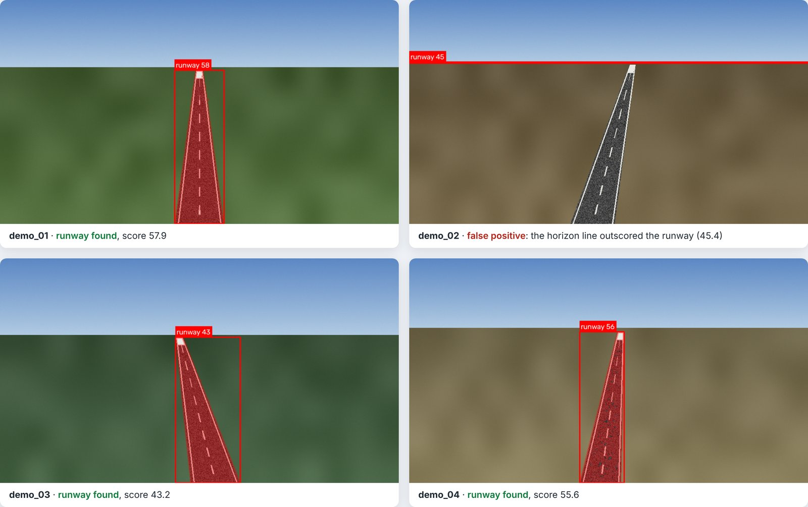
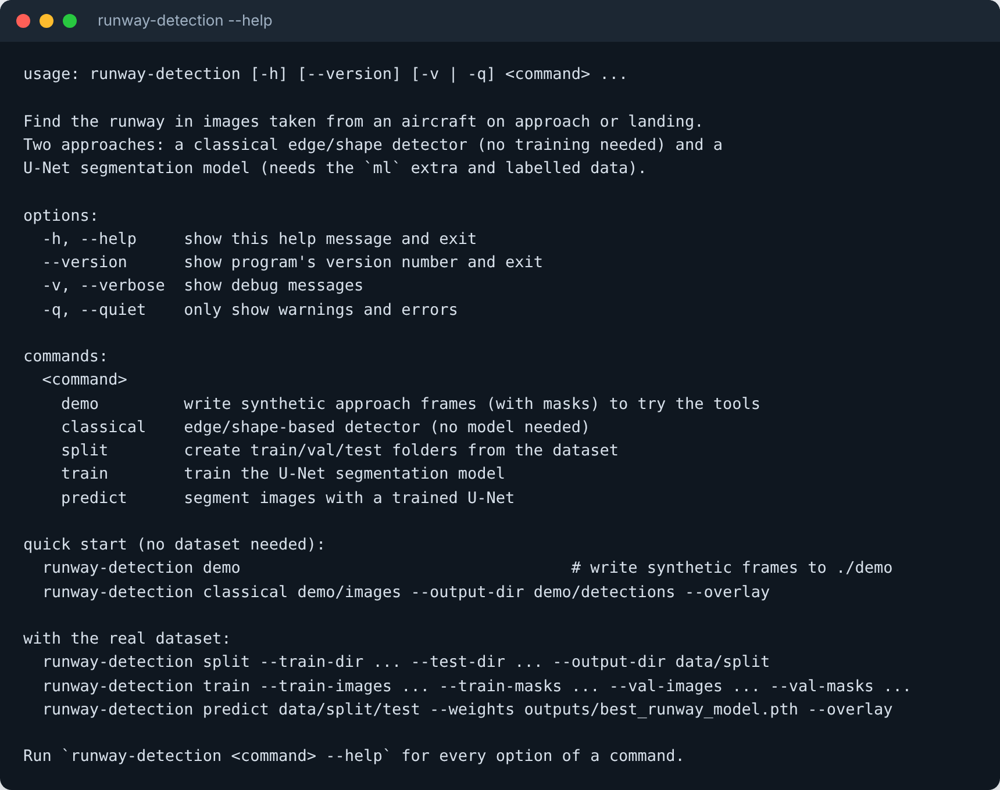
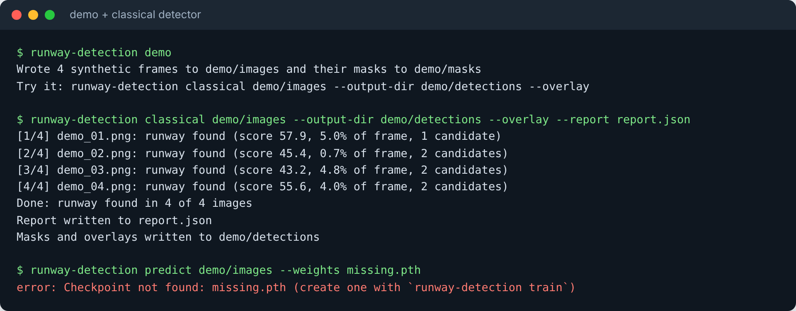
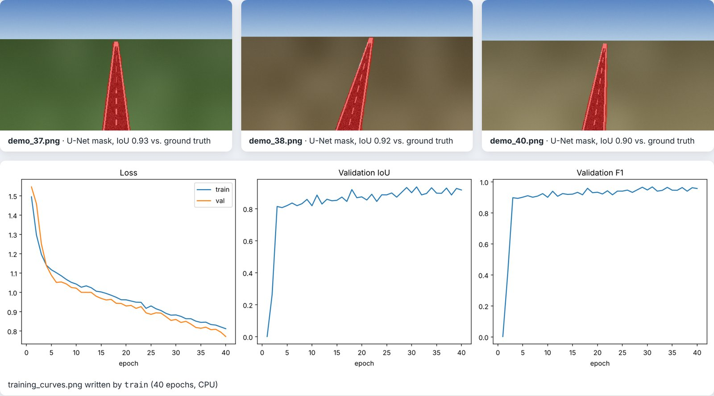
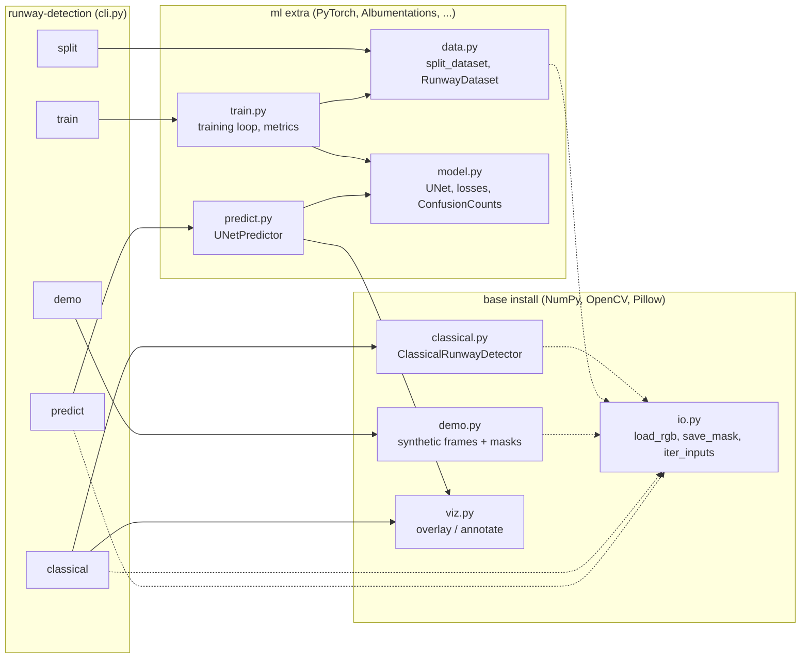
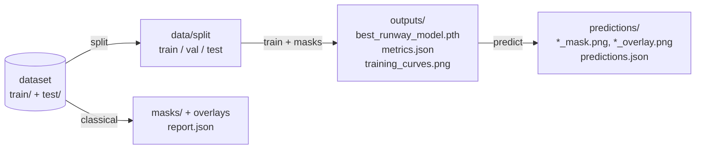

# HackSpace: Runway Detection

**Find the runway in images taken from an aircraft on approach or landing.** You can use a
classical edge-and-shape detector that needs no training, or a U-Net segmentation model you
train on your own labelled frames. Both run from one command-line tool, `runway-detection`,
and from Python.




<sub>Real output of `runway-detection classical --overlay` on the synthetic frames that
`runway-detection demo` generates. The frames are rendered, not photographs. One of the four
is a false positive, shown on purpose: see [Known limitations](#known-limitations).</sub>

---

## Contents

- [Overview](#overview)
- [Features](#features)
- [Screenshots](#screenshots)
- [Tech stack](#tech-stack)
- [Architecture](#architecture)
- [Project structure](#project-structure)
- [Prerequisites](#prerequisites)
- [Installation](#installation)
- [Quick start (no dataset needed)](#quick-start-no-dataset-needed)
- [Configuration](#configuration)
- [Usage](#usage)
- [Command reference](#command-reference)
- [Output formats](#output-formats)
- [Python API reference](#python-api-reference)
- [How it works](#how-it-works)
- [Testing](#testing)
- [Linting and formatting](#linting-and-formatting)
- [Deployment](#deployment)
- [Troubleshooting and FAQ](#troubleshooting-and-faq)
- [Known limitations](#known-limitations)
- [Roadmap](#roadmap)
- [Contributing](#contributing)
- [License](#license)

---

## Overview

Locating the runway in a forward-looking camera frame is a basic building block for
vision-based landing aids, approach monitoring, and datasets for autonomous flight research.
This project started as a hackathon entry and offers two independent approaches:

| | Classical detector | U-Net segmentation |
|---|---|---|
| **Idea** | The runway is the largest dense, elongated cluster of edges | A CNN predicts a runway probability for every pixel |
| **Needs** | Only NumPy, OpenCV and Pillow | PyTorch, plus labelled image/mask pairs to train on |
| **Speed** | About 70 ms per 1920x1080 frame on a CPU | Depends on hardware; a GPU is recommended for training |
| **Output** | Best candidate's mask, bounding box, shape stats and score | Full-resolution probability map, mask, connected regions |
| **Best for** | Quick baselines and clean scenes; no data required | Real-world accuracy, once you have labels |

**Who it's for:** students and researchers who want a runway-localisation baseline, people
preparing aviation computer-vision datasets, and hackathon teams who need something that
works end to end in minutes.

## Features

Every feature below is implemented in `src/runway_detection/` and covered by the test suite.

- **`demo`**: generates synthetic approach frames (sky, terrain, a runway in perspective with
  centreline and threshold markings) together with ground-truth masks. You can try every
  command without downloading a dataset.
- **`classical`**: runs the edge/shape detector on files or whole folders. It can write a
  binary mask and an annotated overlay (tinted mask, bounding box, score) for each
  detection, and produces a JSON report. There are two presets, `improved` (default) and
  `basic`.
- **`split`**: makes reproducible, seeded train/val/test folders from the dataset's own
  train/test split (about 70/10/20).
- **`train`**: trains a U-Net with augmentation and BCE + Dice loss. It keeps the best
  checkpoint by validation loss and writes `metrics.json` (per-epoch history, plus test
  IoU/precision/recall/F1 when you pass a test set) and `training_curves.png`.
- **`predict`**: runs a trained checkpoint at full input resolution. It writes masks,
  optional red overlays, and `predictions.json` with coverage and connected runway regions.
- **A friendly CLI**: help text with examples for every command, defaults shown, input
  validation with clear messages, `[i/n]` progress lines, `-q`/`-v`, `--version`, and
  documented [exit codes](#exit-codes). JSON reports go to stdout and progress goes to
  stderr, so you can pipe the output.
- **Safe checkpoint loading**: models are always loaded with
  `torch.load(..., weights_only=True)`.
- **A light base install**: the classical detector and `demo` don't need PyTorch.

## Screenshots

All screenshots were captured from the real tool running on the synthetic demo data (no real
or personal imagery).

**Top-level help.** `runway-detection --help` lists the commands, with a quick start:



**A full first run.** This generates the demo frames, runs the classical detector with
overlays, and shows the friendly error for a missing checkpoint:



**U-Net on demo data.** This model was trained for 40 epochs on 36 synthetic frames at
128x128 on a CPU, then `predict --overlay` was run on held-out frames. It shows that the
pipeline works end to end. It is not a benchmark:



## Tech stack

| Layer | Technology | Used for |
|---|---|---|
| Language | Python 3.10+ | Everything |
| Arrays and image ops | NumPy, OpenCV (`opencv-python-headless`) | Gradients, connected components, resizing, drawing |
| Image I/O | Pillow | Reading inputs and writing masks and overlays |
| Deep learning (optional `ml` extra) | PyTorch 2.x | U-Net model, training, inference |
| Augmentation (`ml`) | Albumentations | Flips, rotations, affine jitter, brightness/contrast |
| Plots and progress (`ml`) | Matplotlib, tqdm | `training_curves.png`, per-epoch progress bars |
| Packaging | setuptools via `pyproject.toml` | `pip install`, the `runway-detection` console script |
| Tests (`dev` extra) | pytest | 53 tests on synthetic data |
| Lint and format (`dev`) | Ruff | Linting (`E,F,W,I,B,UP,N,SIM,RUF`) and formatting |

## Architecture



The modules that need PyTorch are imported only inside the `train` and `predict` commands,
so `demo`, `classical` and `split` work on a base install. If PyTorch is missing, those two
commands exit with a one-line hint to install the `ml` extra.

Typical data flow with the real dataset:



## Project structure

```
.
├── pyproject.toml              # package metadata, deps + extras (ml, dev), console script, pytest/ruff config
├── README.md
├── docs/
│   └── screenshots/            # images used in this README (captured from the real tool)
├── src/runway_detection/
│   ├── __init__.py             # public API: ClassicalRunwayDetector, DetectorConfig, DetectionResult
│   ├── __main__.py             # enables `python -m runway_detection`
│   ├── cli.py                  # argparse CLI: demo / classical / split / train / predict, exit codes
│   ├── classical.py            # edge + shape detector, presets, scoring, JSON summary
│   ├── demo.py                 # synthetic approach-frame renderer with ground-truth masks
│   ├── viz.py                  # mask tint, bounding box and label drawing (no torch)
│   ├── io.py                   # image/mask loading and saving, folder expansion
│   ├── data.py                 # seeded split, image/mask pairing, preprocessing, Albumentations, Dataset
│   ├── model.py                # U-Net, BCE+Dice loss, dataset-level confusion metrics, safe loading
│   ├── train.py                # training loop, evaluation, checkpointing, metrics.json, curves
│   └── predict.py              # full-resolution inference, connected regions
└── tests/
    ├── conftest.py             # synthetic runway image fixture
    ├── test_classical.py       # detector internals and presets
    ├── test_io_and_cli.py      # I/O helpers and an end-to-end CLI run
    ├── test_cli_ux.py          # help, validation, exit codes, demo, overlays, error messages
    └── test_unet.py            # U-Net, losses, metrics, dataset, split, checkpoint, short training run
```

`data/`, `archive/`, `outputs/`, `predictions/` and model files (`*.pth`, `*.pt`, `*.ckpt`)
are git-ignored. Datasets and weights never belong in the repository.

## Prerequisites

- **Python 3.10 or newer** (tested on 3.13).
- **pip** and **venv** (included with Python).
- **For the U-Net:** enough RAM or GPU memory for 512x512 batches. If you run out, lower
  `--batch-size` or `--image-size`. CPU training works but is slow at full size.
- **Optional:** an NVIDIA GPU with a CUDA build of PyTorch.
- **Optional:** the dataset, if you want to train (see [Data layout](#data-layout)).

No system libraries are required: OpenCV is installed as the headless wheel.

## Installation

```bash
# 1. Get the code
git clone https://github.com/jeevithg090/HackSpace.git
cd HackSpace

# 2. Create and activate a virtual environment
python -m venv .venv
source .venv/bin/activate            # Windows: .venv\Scripts\activate

# 3. Install. Pick the line that matches what you need
pip install -e .                     # classical detector + demo only (no PyTorch)
pip install -e '.[ml]'               # + U-Net training and inference
pip install -e '.[ml,dev]'           # + pytest and Ruff for development

# 4. Check it works
runway-detection --version
```

**GPU users:** install the PyTorch build for your CUDA version first, using the selector on
[pytorch.org](https://pytorch.org/get-started/locally/). Then run step 3. pip keeps the
build you already installed.

**Without the console script:** `python -m runway_detection ...` behaves the same.

## Quick start (no dataset needed)

```bash
runway-detection demo                                   # writes demo/images and demo/masks
runway-detection classical demo/images --output-dir demo/detections --overlay --report report.json
```

Open `demo/detections/*_overlay.png` to see what was detected, and `report.json` for the
numbers. With the `ml` extra installed you can also run the whole U-Net pipeline on demo data;
see [Train a U-Net on demo data](#4-train-a-u-net-on-demo-data-smoke-test).

## Configuration

### Environment variables

**None.** The tool reads no environment variables and needs no secrets, API keys or
`.env` file. Everything is set with command-line flags (see the
[command reference](#command-reference)) or, from Python, with `DetectorConfig` and
`TrainConfig`.

The usual PyTorch and CUDA variables still apply, because PyTorch reads them itself. For
example, `CUDA_VISIBLE_DEVICES=1 runway-detection train ...` selects a GPU.

### Detector parameters (`DetectorConfig`)

These fields control the classical detector. The CLI exposes them through `--preset`. From
Python you can override any of them: `ClassicalRunwayDetector("improved", edge_threshold=30)`.

| Field | `improved` | `basic` | Meaning |
|---|---|---|---|
| `equalize` | `True` | `False` | Histogram-equalise the grayscale image first |
| `gradient` | `"sobel"` | `"central"` | 3x3 Sobel or central-difference gradient |
| `edge_threshold` | `20` | `25` | Threshold on the edge map after normalising it to 0-255 |
| `dilate` | `True` | `False` | 3x3 dilation so broken markings join up |
| `min_component_pixels` | `300` | `500` | Ignore components with this many pixels or fewer |
| `min_area` / `max_area` | `2000` / `300000` | `5000` / `200000` | Area window used for scoring and filtering |
| `min_aspect_ratio` / `max_aspect_ratio` | `0.1` / `10.0` | same | Aspect window (height / width) used in scoring |
| `min_fill_ratio` | `0.2` | `0.3` | Minimum share of the bounding box that the component fills |
| `max_frame_fraction` | `0.5` | same | Drop components larger than this share of the frame (texture clutter) |
| `ranking` | `"score"` | `"area"` | Rank by weighted score, or apply hard filters and rank by area |
| `min_score` | `30.0` | n/a | With `ranking="score"`, drop candidates at or below this score |

### Training parameters (`TrainConfig`)

Every field has a matching `train` flag, except `weight_decay` (1e-5) and `threshold`
(0.5), which you can set from Python only.

## Usage

### 1. Classical detection

```bash
# One image, JSON report on stdout
runway-detection classical frame.png

# A folder: masks + annotated overlays + a report file
runway-detection classical images/ --output-dir masks/ --overlay --report report.json

# The 'basic' preset, quiet, report piped to a file
runway-detection classical images/ --preset basic -q > report.json

# Mix files and folders
runway-detection classical a.png b.jpg more_frames/
```

The command prints progress to stderr:

```
[1/4] demo_01.png: runway found (score 57.9, 5.0% of frame, 1 candidate)
[2/4] demo_02.png: runway found (score 45.4, 0.7% of frame, 2 candidates)
...
Done: runway found in 4 of 4 images
```

### 2. Build train/val/test splits

```bash
runway-detection split \
  --train-dir archive/1920x1080/1920x1080/train \
  --test-dir  archive/1920x1080/1920x1080/test \
  --output-dir data/split
# Split written to data/split: train=... val=... test=...
```

Everything in `--train-dir` goes to `train/`. `--test-dir` is shuffled with `--seed` (default
42) and divided into `val/` (`--val-fraction`, default 1/3) and `test/`. Files are copied, so
the originals are left untouched.

### 3. Train the U-Net

```bash
runway-detection train \
  --train-images data/split/train --train-masks archive/labels/labels/areas/train_labels_1920x1080 \
  --val-images   data/split/val   --val-masks   archive/labels/labels/areas/test_labels_1920x1080 \
  --test-images  data/split/test  --test-masks  archive/labels/labels/areas/test_labels_1920x1080 \
  --epochs 50 --batch-size 4 --output-dir outputs/
```

The val and test masks both come from the original test labels, because `split` divides the
original test images. Masks are matched to images **by file name**, and images without a mask
are skipped.

Output:

```
outputs/
├── best_runway_model.pth     # state_dict of the best epoch (lowest validation loss)
├── metrics.json              # config, per-epoch history, best val loss, optional test metrics
└── training_curves.png       # loss, validation IoU and F1 per epoch (skip with --no-plot)
```

### 4. Train a U-Net on demo data (smoke test)

This checks that your PyTorch install and the whole pipeline work before you spend hours on
real data. It takes a few minutes on a CPU:

```bash
runway-detection demo --count 48 --size 480x270 --output-dir demo
mkdir -p raw/train raw/test
ls demo/images | head -36 | xargs -I{} cp demo/images/{} raw/train/
ls demo/images | tail -12 | xargs -I{} cp demo/images/{} raw/test/
runway-detection split --train-dir raw/train --test-dir raw/test --output-dir data/split
runway-detection train \
  --train-images data/split/train --train-masks demo/masks \
  --val-images   data/split/val   --val-masks   demo/masks \
  --test-images  data/split/test  --test-masks  demo/masks \
  --epochs 40 --image-size 128 --num-workers 0 --output-dir outputs
runway-detection predict data/split/test --weights outputs/best_runway_model.pth \
  --image-size 128 --overlay
```

This produced the U-Net screenshot above. On the 8 held-out synthetic frames, that run
reached test IoU 0.92 and F1 0.96 (from `metrics.json`). Synthetic frames are far easier than
real imagery, so don't read these numbers as real-world accuracy.

### 5. Predict with a trained model

```bash
runway-detection predict data/split/test \
  --weights outputs/best_runway_model.pth \
  --output-dir predictions/ --overlay --threshold 0.5
```

Use the same `--image-size` that you trained with (default 512).

### 6. From Python

```python
from runway_detection import ClassicalRunwayDetector
from runway_detection.io import load_rgb, save_mask
from runway_detection.viz import annotate

image = load_rgb("frame.png")
result = ClassicalRunwayDetector("improved").detect(image)
if result.success:
    best = result.main
    print(best.score, best.stats.bbox, result.coverage())
    save_mask(result.mask(), "frame_mask.png")
    overlay = annotate(image, result.mask(), best.stats.bbox, f"runway {best.score:.0f}")
```

```python
from runway_detection.predict import UNetPredictor
from runway_detection.io import load_rgb

seg = UNetPredictor("outputs/best_runway_model.pth", device="cpu").predict(load_rgb("frame.png"))
print(f"{seg.coverage:.2f}% runway", seg.regions())  # probability map in seg.probability
```

```python
from runway_detection.demo import write_demo_dataset

paths = write_demo_dataset("demo", count=8, width=1920, height=1080)
```

## Command reference

Global options go before or after the command name. For example, `runway-detection -q
classical ...` and `runway-detection classical -q ...` are equivalent.

| Option | Description |
|---|---|
| `-h`, `--help` | Show help (every command has its own `--help` with examples) |
| `--version` | Print the version and exit |
| `-v`, `--verbose` | Show debug messages |
| `-q`, `--quiet` | Only show warnings and errors |

### Commands

| Command | Needs | What it does |
|---|---|---|
| `demo` | base | Writes synthetic frames and masks to `DIR/images` and `DIR/masks` |
| `classical` | base | Runs the classical detector; JSON report, optional masks and overlays |
| `split` | base | Copies the dataset into seeded `train/`, `val/` and `test/` folders |
| `train` | `ml` | Trains the U-Net; checkpoint, `metrics.json`, `training_curves.png` |
| `predict` | `ml` | Segments images with a checkpoint; masks, overlays, `predictions.json` |

### `demo`

| Flag | Default | Description |
|---|---|---|
| `--output-dir DIR` | `demo` | Writes `DIR/images/*.png` and `DIR/masks/*.png` |
| `--count N` | `4` | Number of frames (at least 1) |
| `--size WxH` | `960x540` | Frame size; both sides must be at least 64 px |

### `classical`

| Flag | Default | Description |
|---|---|---|
| `INPUT ...` | (required) | Image files and/or folders (`.png .jpg .jpeg .bmp .tif .tiff`; hidden files skipped) |
| `--preset {improved,basic}` | `improved` | Detector settings (see [Detector parameters](#detector-parameters-detectorconfig)) |
| `--output-dir DIR` | (none) | Write `<name>_mask.png` for every image with a detection |
| `--overlay` | off | Also write `<name>_overlay.png` (needs `--output-dir`) |
| `--report FILE` | stdout | Write the JSON report to a file instead |

### `split`

| Flag | Default | Description |
|---|---|---|
| `--train-dir DIR` | (required) | Original training images |
| `--test-dir DIR` | (required) | Original test images |
| `--output-dir DIR` | (required) | Creates `DIR/train`, `DIR/val`, `DIR/test` |
| `--val-fraction F` | `0.3333` | Share of the test set that becomes validation; strictly between 0 and 1 |
| `--seed N` | `42` | Shuffle seed |

### `train`

| Flag | Default | Description |
|---|---|---|
| `--train-images DIR` / `--train-masks DIR` | (required) | Training images and masks (same file names) |
| `--val-images DIR` / `--val-masks DIR` | (required) | Validation images and masks |
| `--test-images DIR` / `--test-masks DIR` | (none) | Optional held-out set, evaluated with the best checkpoint; give both or neither |
| `--epochs N` | `50` | Training epochs |
| `--batch-size N` | `4` | Images per batch |
| `--lr RATE` | `0.0001` | Adam learning rate (weight decay 1e-5; LR halves after 5 epochs without val improvement) |
| `--image-size PX` | `512` | Images are resized to PX x PX |
| `--num-workers N` | `2` | DataLoader workers; `0` loads in the main process |
| `--seed N` | `42` | Random seed |
| `--device NAME` | auto | `cpu`, `cuda`, `cuda:1`, ... (default: CUDA if available) |
| `--output-dir DIR` | `outputs` | Where the checkpoint, metrics and curves go |
| `--no-plot` | off | Skip `training_curves.png` |

### `predict`

| Flag | Default | Description |
|---|---|---|
| `INPUT ...` | (required) | Image files and/or folders |
| `--weights FILE` | (required) | Checkpoint written by `train` |
| `--output-dir DIR` | `predictions` | Masks, overlays and `predictions.json` |
| `--threshold P` | `0.5` | Probability above which a pixel is runway; strictly between 0 and 1 |
| `--image-size PX` | `512` | Must match the training size |
| `--device NAME` | auto | `cpu`, `cuda`, ... |
| `--overlay` | off | Also write `<name>_overlay.png` with runway pixels tinted red |

### Exit codes

| Code | Meaning |
|---|---|
| `0` | Success |
| `1` | Runtime error: missing file or folder, no images found, unreadable or corrupt checkpoint, missing `ml` extra. Also returned when *no* input image could be read (a run where only some images are unreadable still succeeds, with warnings) |
| `2` | Invalid command line, such as an unknown flag, an out-of-range value, or no command given |
| `130` | Interrupted with Ctrl+C |

## Output formats

### `classical` report (JSON array, one entry per input)

```json
{
  "image": "demo/images/demo_01.png",
  "success": true,
  "num_candidates": 1,
  "image_shape": [540, 960, 3],
  "main_runway": {
    "score": 57.93,
    "area": 25881,
    "bbox": [420, 169, 120, 371],
    "center": [479.5, 399.8],
    "aspect_ratio": 3.092,
    "fill_ratio": 0.581,
    "elongation": 3.092,
    "coverage_percent": 4.992
  },
  "mask": "demo/detections/demo_01_mask.png",
  "overlay": "demo/detections/demo_01_overlay.png"
}
```

This is real output from the demo run above. `bbox` is `[x, y, width, height]` in pixels,
`aspect_ratio` is height divided by width, and `fill_ratio` is the share of the bounding box
covered by edge pixels. `mask` and `overlay` appear only when they were written. Images
without a detection have `"success": false` and no `main_runway`. Unreadable images get an
`"error"` field instead.

### `predict` report (`predictions.json`)

```json
[
  {
    "image": "data/split/test/demo_37.png",
    "mask": "predictions/demo_37_mask.png",
    "coverage_percent": 5.054,
    "regions": [{"bbox": [211, 85, 59, 185], "center": [239.7, 198.5], "area": 6550}],
    "overlay": "predictions/demo_37_overlay.png"
  }
]
```

This is real output from the demo U-Net run (centre coordinates rounded here). `regions`
lists the connected runway components larger than 1000 px, largest first.

### Masks

Masks are single-channel 8-bit PNGs at the input resolution: 255 is runway, 0 is background.
Training masks may use any non-zero value for runway, so colour-coded label images work.

## Python API reference

There is no HTTP server, so this is the public Python API.

| Object | Module | Description |
|---|---|---|
| `ClassicalRunwayDetector(config="improved", **overrides)` | `runway_detection` | `.detect(image) -> DetectionResult`; `config` is a preset name or a `DetectorConfig` |
| `DetectorConfig` | `runway_detection` | Frozen dataclass of detector parameters (table above) |
| `DetectionResult` | `runway_detection` | `.success`, `.main`, `.candidates`, `.mask(i)`, `.coverage()`, `.summary()` |
| `load_rgb(path)` / `load_mask(path)` | `runway_detection.io` | Read an image as `HxWx3 uint8`, or a mask as `HxW bool`; raise `ImageLoadError` |
| `save_mask(mask, path)` | `runway_detection.io` | Write a 0/255 PNG, creating parent folders |
| `iter_inputs(paths)` / `list_images(dir)` | `runway_detection.io` | Expand files and folders into a sorted list of images |
| `overlay(image, mask, alpha)` / `annotate(image, mask, bbox, label)` | `runway_detection.viz` | Visualisations (no PyTorch needed) |
| `render_scene(scene, width, height, seed)` / `write_demo_dataset(dir, count, ...)` | `runway_detection.demo` | Synthetic frames and masks |
| `split_dataset(train_dir, test_dir, out, val_fraction, seed)` | `runway_detection.data` | Seeded split; returns `SplitSummary` |
| `RunwayDataset`, `build_transforms`, `preprocess` | `runway_detection.data` | Training dataset and preprocessing (`ml`) |
| `UNet`, `bce_dice_loss`, `ConfusionCounts`, `load_unet` | `runway_detection.model` | Model, loss, dataset-level metrics, safe loading (`ml`) |
| `TrainConfig`, `train(cfg)` | `runway_detection.train` | Training entry point; returns a summary dict (`ml`) |
| `UNetPredictor(weights, image_size, device)` | `runway_detection.predict` | `.predict(image, threshold) -> SegmentationResult` (`ml`) |

## How it works

### Classical detector

```
RGB ─▶ luminance gray ─▶ [histogram equalisation] ─▶ gradient magnitude (Sobel / central diff)
    ─▶ normalise to 0-255 + threshold ─▶ [3x3 dilation] ─▶ 8-connected components
    ─▶ shape stats ─▶ drop frame-filling clutter ─▶ score or filter ─▶ ranked candidates
```

For each component the detector measures area, bounding box, aspect ratio, fill ratio and
elongation. The `improved` preset scores candidates out of roughly 100: up to 30 points for
area, 25 for an elongated aspect ratio, up to 35 for fill ratio, and 10 if elongation is above
3. Candidates scoring 30 or less are dropped. The `basic` preset applies hard filters instead
and ranks by area. Everything is vectorised with NumPy and OpenCV in float32.

### U-Net

- A four-level U-Net (64-128-256-512 channels, 1024 at the bottleneck) with batch norm. It
  outputs logits and trains on `BCEWithLogits + soft Dice`. Inputs of any size work: decoder
  features are resized to match the skip connections.
- Inputs are resized to 512x512 (configurable) and normalised with ImageNet statistics.
  Training adds horizontal and vertical flips, 90° rotations, a small affine jitter and
  brightness/contrast changes.
- Adam (lr 1e-4, weight decay 1e-5) with ReduceLROnPlateau (factor 0.5, patience 5) on
  validation loss.
- Metrics (IoU, precision, recall, F1) come from pixel confusion counts accumulated over the
  whole split, not averaged per batch.
- At inference, the probability map is resized back to the input resolution before
  thresholding.

### Demo frames

`demo.py` draws a sky gradient, smooth low-frequency terrain, and a trapezoidal runway
(textured asphalt, side stripes, centreline dashes and threshold bars) with mild sensor
noise. Each frame is deterministic for its seed. Four scene layouts rotate as `--count`
grows.

## Testing

```bash
pip install -e '.[ml,dev]'
python -m pytest            # 53 tests, about 10-25 s on a laptop CPU
python -m pytest -k cli     # only the CLI tests
```

All tests use synthetic images, so no dataset is needed. They cover:

- **Classical detector:** grayscale weights, edge-map overflow, region measurements, the
  scoring formula, both presets on a synthetic runway, rejecting flat and noisy frames, and
  rejecting frame-filling clutter.
- **CLI and UX:** help and examples for every command, `--version`, no-command help,
  validation of bad values (exit 2), `-q`/`-v` placement, demo output, overlays, JSON on
  stdout, and error messages and exit codes for empty folders, unreadable images, missing or
  corrupt checkpoints, and missing training folders (checked before anything is written).
- **I/O:** mask round-trip, folder listing and filtering, mixed file/folder inputs.
- **U-Net:** output size for odd inputs, losses, metrics, preprocessing parity with
  Albumentations, dataset pairing and mask binarisation, split determinism, checkpoint
  round-trip, overlays, and a short CPU training run that must learn.

Without PyTorch (`pip install -e '.[dev]'`), the U-Net tests are skipped automatically and
everything else runs.

## Linting and formatting

```bash
ruff check .            # lint
ruff format --check .   # check formatting
ruff format .           # apply formatting
```

The configuration lives in `pyproject.toml`: line length 100, target Python 3.10, rules
`E, F, W, I, B, UP, N, SIM, RUF`.

## Deployment

This is a command-line tool and library, not a web service, so "deploying" means installing
it where the images are.

1. **Build a wheel** on any machine: `pip wheel . -w dist/ --no-deps`. This produces
   `dist/runway_detection-0.1.0-py3-none-any.whl`.
2. **Install on the target:** `pip install dist/runway_detection-0.1.0-py3-none-any.whl`.
   For the U-Net, install the extra too:
   `pip install "dist/runway_detection-0.1.0-py3-none-any.whl[ml]"`.
3. **Copy the checkpoint** (`best_runway_model.pth`) separately. Weights are not packaged or
   committed.
4. **Run in batch:** `runway-detection predict /data/frames --weights model.pth -q
   --output-dir /data/out`. The exit codes make it easy to use from cron jobs, Makefiles or
   CI scripts.

The classical detector needs only the base install (NumPy, OpenCV headless, Pillow), so it
runs on any machine with wheels for those packages, without PyTorch.

The repository has no Dockerfile or hosted demo.

## Troubleshooting and FAQ

**`error: No module named 'torch'. Install the ML extras with: pip install -e '.[ml]'`**
You ran `train` or `predict` on a base install. Install the `ml` extra. `demo`, `classical`
and `split` don't need it.

**`runway-detection: command not found`**
The virtual environment isn't active, or the package isn't installed in it. Run
`source .venv/bin/activate`, or use `python -m runway_detection ...`.

**`error: No images found in ...`**
The folder contains no `.png/.jpg/.jpeg/.bmp/.tif/.tiff` files. Hidden files are skipped,
and folders are not searched recursively, so point at the folder that holds the images.

**`train` says `No image/mask pairs found`**
Masks are matched to images by **exact file name**, including the extension. Check that, for
example, `train/EDDF_001.png` has a matching `masks/EDDF_001.png`.

**`error: Could not load ... as a U-Net checkpoint saved by train`**
The file is not a `state_dict` saved by this project's `train` command (or it is corrupt).
Full pickled models are refused on purpose, because loading uses `weights_only=True`.

**Predictions are empty or all background**
Check that `--image-size` matches the size you trained with, and try a lower `--threshold`
(for example `0.3`). Very short training runs often predict nothing.

**CUDA out of memory**
Lower `--batch-size` (try 2), lower `--image-size` (try 384 or 256), or train on `--device cpu`.

**Training is very slow on CPU**
Expected at 512x512. For a smoke test use `--image-size 128 --epochs 5`. For real training
use a GPU.

**DataLoader errors on Windows or macOS (worker processes)**
Use `--num-workers 0`.

**The classical detector picks the horizon or another wrong object**
This is a known weakness of the heuristic; see below. Try `--preset basic`, or tune
`DetectorConfig` from Python (for example, raise `min_area` or `min_score`).

## Known limitations

- **No trained model or real-data benchmark is included.** The dataset isn't in the
  repository, so there are no accuracy numbers on real images for either approach. Train on
  your data and measure.
- **The classical detector is a heuristic.** It assumes the runway is the largest dense,
  elongated edge cluster. Long straight edges, such as the horizon, roads and building
  edges, can outscore the runway: `demo_02` in the screenshot above is a real example. Busy
  textured ground causes similar mistakes. Wide, close-up runways that aren't elongated in
  the frame can score below the threshold.
- **The demo frames are synthetic** and much simpler than real imagery. They exist for trying
  the tools and for smoke tests, not for evaluation.
- **Only one runway is reported** by the classical detector (the top candidate). The others
  are available from Python through `DetectionResult.candidates`.
- **The U-Net resizes inputs to a square**, which distorts the aspect ratio of wide frames.
  Tiling or letterboxing could help with thin, distant runways.
- **No model export** (ONNX or TorchScript) and no Docker image yet.

## Roadmap

Ideas that would add real value, roughly in priority order:

1. Train on the real dataset and publish IoU/F1 for both approaches, with a reproducible
   evaluation command.
2. An `evaluate` command that scores classical masks against ground truth, so the two
   approaches can be compared directly.
3. Horizon-aware filtering in the classical detector (penalise near-horizontal,
   full-width components).
4. A pretrained encoder (for example ResNet) for the U-Net, plus mixed-precision training.
5. ONNX export and a small Dockerfile for batch inference.
6. Video input (frame-by-frame with temporal smoothing).

## Contributing

1. Fork the repository and create a branch: `git checkout -b feature/my-change`.
2. Install the dev setup: `pip install -e '.[ml,dev]'`.
3. Make your change and add tests under `tests/` (synthetic data only; never commit datasets
   or weights).
4. Make sure all three checks pass before opening a pull request:
   ```bash
   ruff check . && ruff format --check . && python -m pytest
   ```
5. Use [Conventional Commits](https://www.conventionalcommits.org/) messages (`feat:`,
   `fix:`, `docs:`, `test:`, `refactor:`, `chore:`), and describe in the PR what you changed
   and how you verified it.

Bug reports are most useful with the exact command, the full error output (`-v` helps), your
Python and PyTorch versions, and, if you can share one, an image that reproduces the problem.

## License

The repository does not have a license yet, so by default all rights are reserved by the
author. If you want others to use and contribute to the project, adding a permissive license
such as **MIT** or **Apache-2.0** is recommended. Apache-2.0 also includes an explicit patent
grant. Check the terms of whichever dataset you train on separately: dataset licences often
restrict how images and derived models may be shared.
